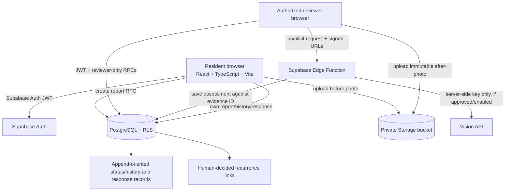

# CivicLens Check the Fix — architecture

- Browser code contains only the project URL and publishable/anon key. Privileged keys and vision provider secrets remain server-side.
- Private images are accessed using short-lived signed URLs after database/storage authorization.
- The original report photo path is not changed by the Check the Fix workflow. After-photos are separately stored and versioned.
- AI output is advisory and attached to a specific after-evidence ID and before-photo path. A later after-photo makes the older assessment non-current without deleting it.
- Status changes and history entries are written in the same database function transaction.
- Recurrence suggestions use a documented 150 m / 90-day default, category and data-class match, and prior reviewer-verified status. A reviewer decides the link; reports are not merged.
- Database owners/service-role administrators retain exceptional powers. The design is not described as tamper-proof.
